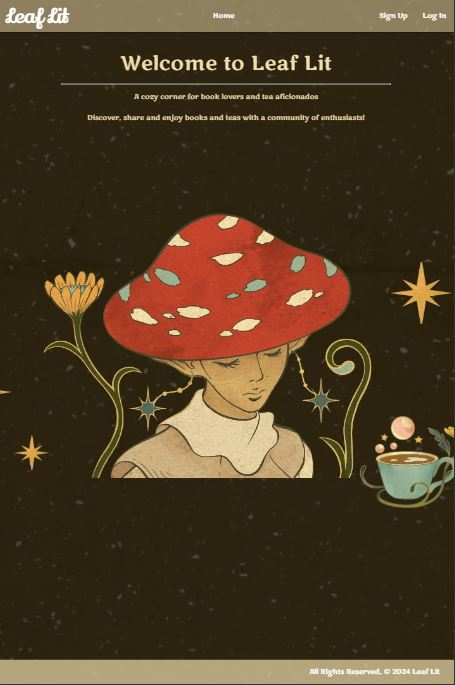
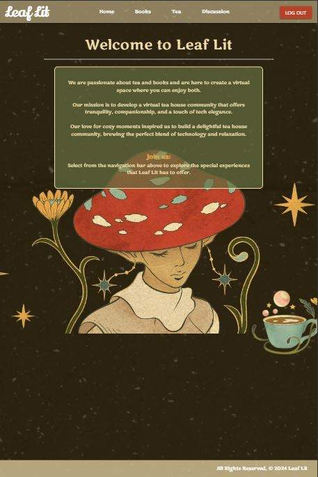
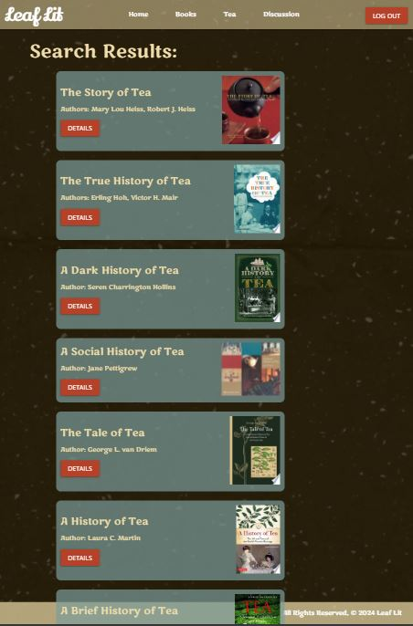
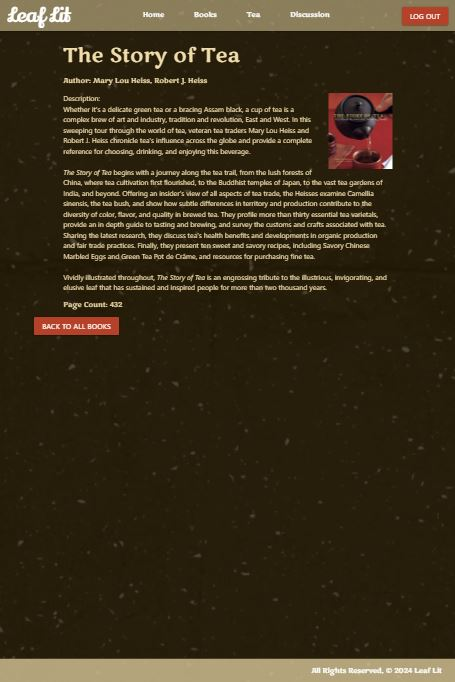
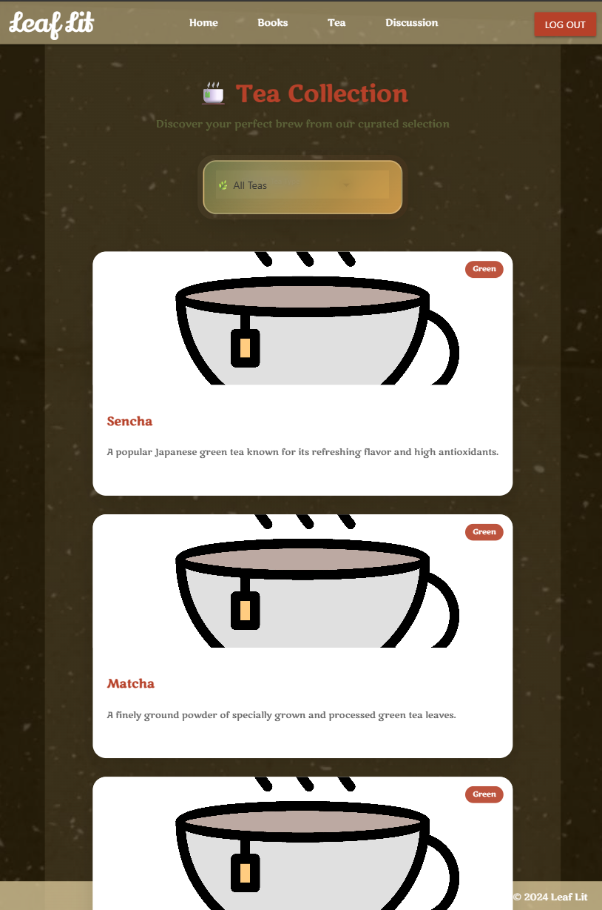
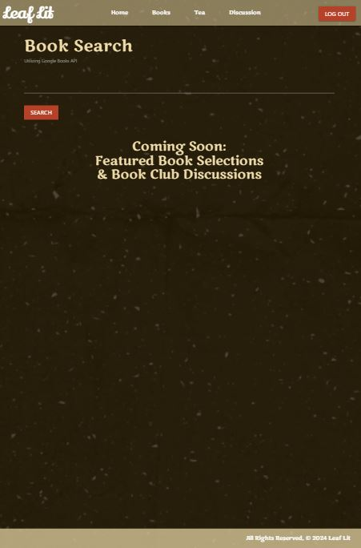
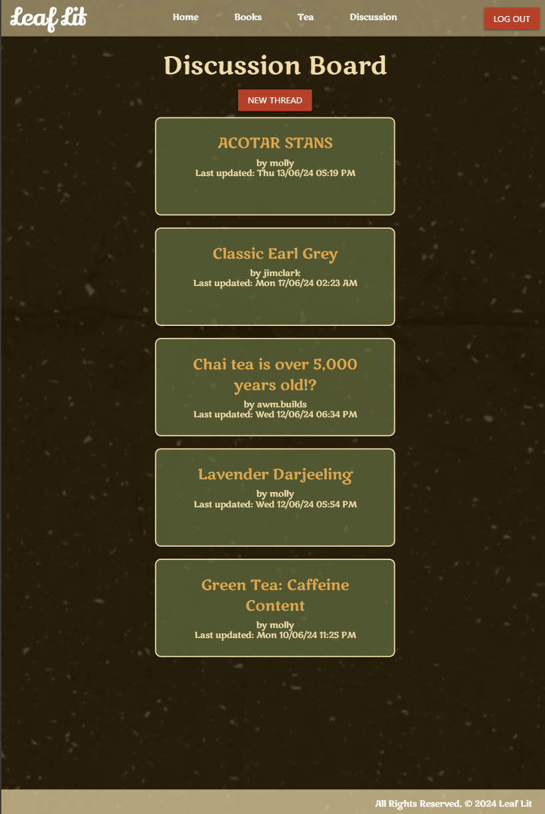
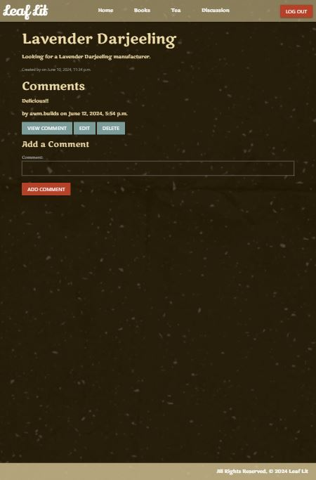
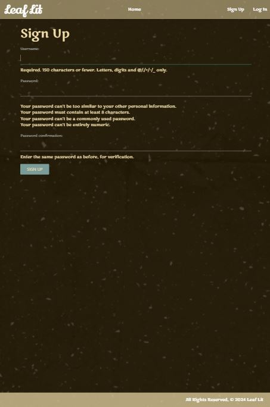

# 🍃 Leaf Lit: The Literary Tea Companion

## ⚠️ Deployment Update — August 2026
Leaf Lit is currently undergoing a full deployment modernization.  
The previous **Heroku** environment has been sunset, and the application is now being **Dockerized and migrated to Fly.io** for long‑term stability and reproducible infrastructure.

The live link is temporarily offline during this transition, but the **full codebase remains available**, and an updated deployment will be published this week.

## Overview

Leaf Lit is an innovative web application that elegantly bridges the worlds of literature and tea culture. This sophisticated platform empowers users to discover the perfect harmony between their favorite literary works and carefully curated tea selections.

Upon registration, members gain access to a comprehensive ecosystem where they can search for beloved books, explore an extensive catalog of tea varieties, and engage in meaningful discussions about literary-tea pairings with fellow enthusiasts. The application fosters a vibrant community where seasoned connoisseurs and curious newcomers alike can share insights, discover new combinations, and contribute to an ever-growing repository of knowledge.

Whether you're a bibliophile seeking the perfect brew to accompany your next read, or a tea aficionado looking to enhance your literary journey, Leaf Lit provides an immersive experience that celebrates the timeless ritual of pairing exceptional literature with extraordinary tea.

## 📸 Application Gallery

  <h3>🏠 Home & Navigation</h3>
  
  
  
  <h3>📚 Book Discovery & Details</h3>
  
  
  
  <h3>🍵 Tea Collection & Insights</h3>
  
  
  
  <h3>💬 Community Discussion</h3>
  
  
  
  <h3>👤 User Experience</h3>
  
  
  

## 🛠️ Technology Stack

### 🎨 Frontend Technologies
- **HTML5** - Semantic markup and structure
- **CSS3** - Modern styling with responsive design
- **JavaScript** - Interactive user experience

### ⚙️ Backend Architecture  
- **Python** - Core programming language
- **Django** - Robust web framework
- **PostgreSQL** - Reliable relational database

### 🔌 External Services
- **Google Books API** - Comprehensive book data integration
- **Heroku** - Cloud deployment and hosting

### 🌐 Live Application
**[🚀 Experience Leaf Lit](https://leaflit-3bc5fa4fe5ca.herokuapp.com/)**

## 🚀 Getting Started

### Quick Start Guide

Ready to embark on your literary tea journey? Access the fully deployed application instantly:

**[🌟 Launch Leaf Lit Application](https://leaflit-3bc5fa4fe5ca.herokuapp.com/)**

### 📋 Project Documentation

For comprehensive project insights, including detailed user stories, architectural wireframes, and the complete Entity-Relationship Diagram (ERD), explore our project management hub:

**[📊 View Project Planning Board](https://trello.com/b/vjQHYjbG/project4-tea)**

## 🔮 Future Enhancements

Our roadmap includes several exciting features to further enrich the Leaf Lit experience:

### 🎯 Planned Features
- **🔐 Enhanced User Profiles** - Implement sophisticated user authentication with personalized tea recommendation algorithms
- **⭐ Community Reviews** - Enable users to contribute detailed tea reviews and ratings, fostering community-driven content
- **📱 Social Integration** - Introduce social sharing capabilities, allowing users to showcase their favorite literary-tea pairings across social platforms

### 💡 Vision
These enhancements will transform Leaf Lit into a comprehensive social platform where literature and tea culture intersect, creating meaningful connections between readers, tea enthusiasts, and the broader community of connoisseurs.

---

*Crafted with ☕ and 📚 by passionate developers who believe in the perfect pairing of literature and tea.*
